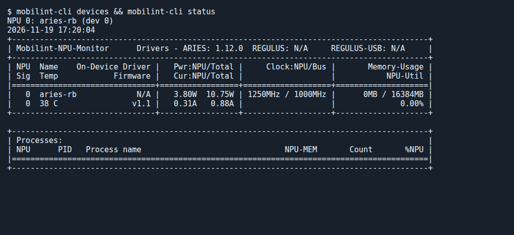
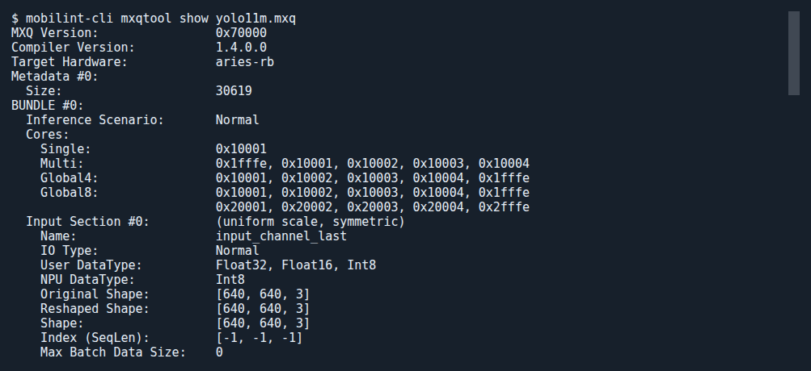
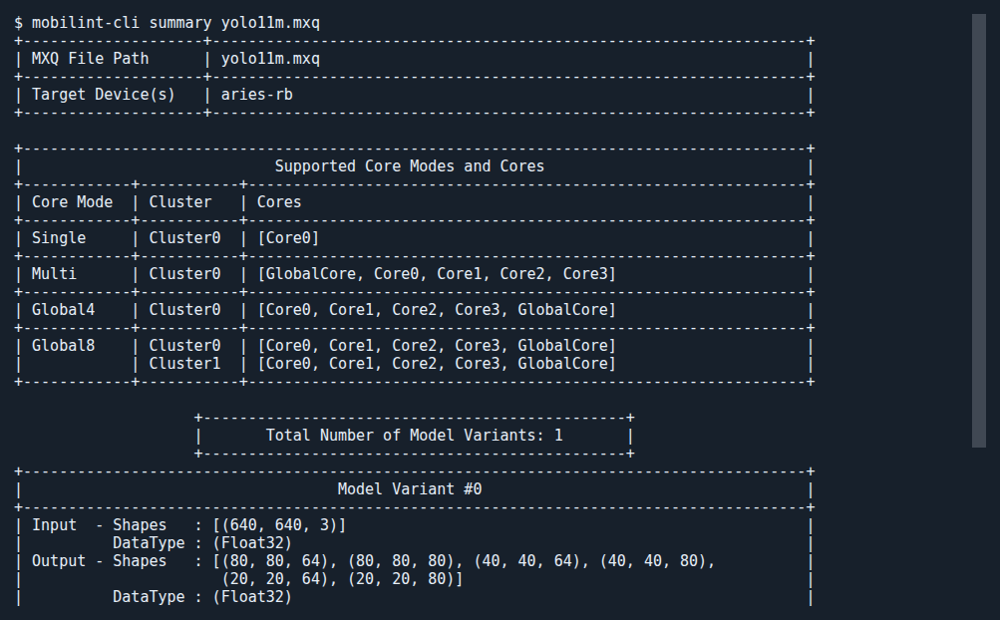
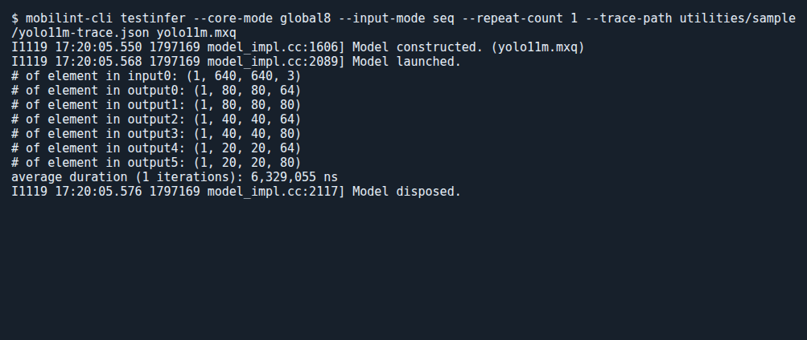
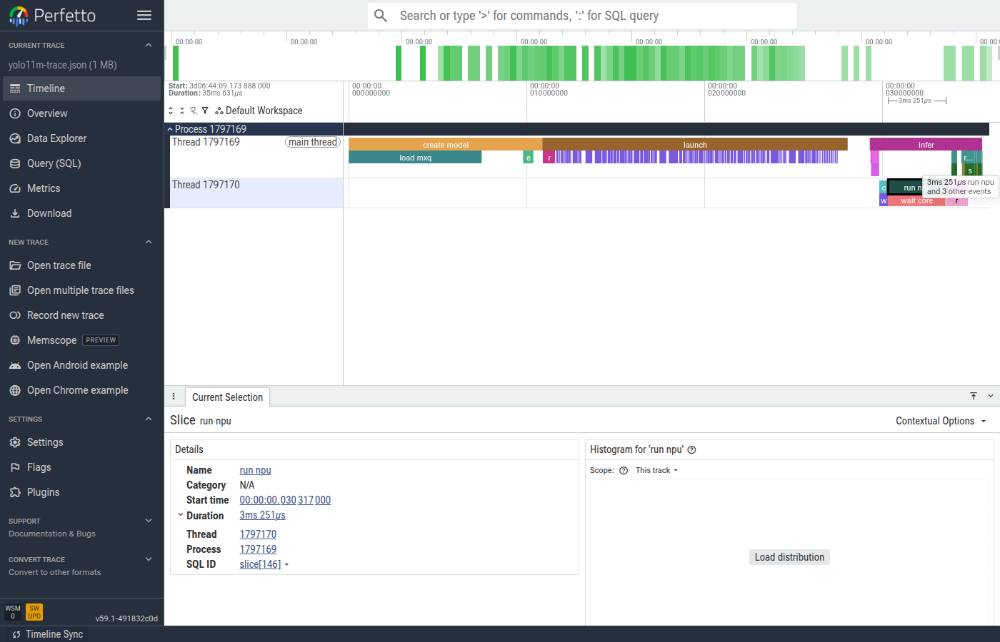
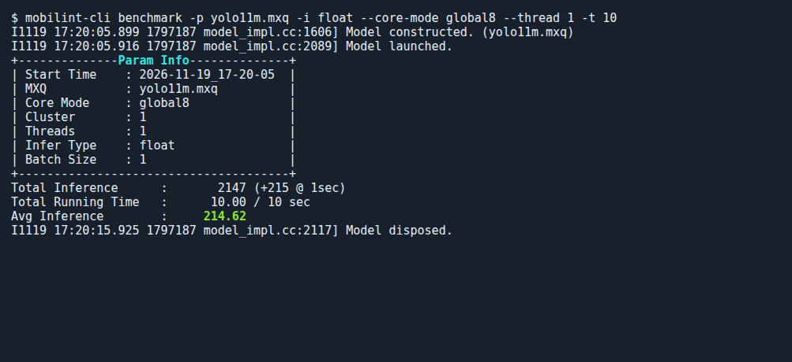

# mobilint-cli 사용법

[English](usage.md) | 한국어

이 가이드는 NPU 상태 확인, MXQ 파일 검사, 추론 프로파일링, 처리량 측정에 유용한 `mobilint-cli`의 대표적인 사용법을 소개합니다.

## ARIES-RB용 YOLO11m 다운로드

이 예시는 CLI v1.6.0과 [Mobilint의 YOLO11m](https://huggingface.co/mobilint/YOLO11m)을 사용합니다. 모델을 컴파일할 필요는 없습니다.
저장소 루트에서 최신 [ARIES-RB용 MXQ](https://huggingface.co/mobilint/YOLO11m/blob/main/aries-rb/yolo11m.mxq)를 내려받으세요.

```bash
curl -fL -o yolo11m.mxq \
  https://huggingface.co/mobilint/YOLO11m/resolve/main/aries-rb/yolo11m.mxq
```

이후 예제도 같은 디렉터리에서 실행하세요.

## NPU 상태 확인

```bash
mobilint-cli devices
mobilint-cli status
```

- `devices`에서 장치 번호와 모델명을 확인하세요.
- `status`는 NVIDIA GPU의 `nvidia-smi`처럼 Mobilint NPU의 온도, 메모리 사용량, 사용률을 보여줍니다.
- 1초마다 갱신하려면 `mobilint-cli status -l 1`을 실행하세요. 종료하려면 `Ctrl+C`를 누르세요.



## mxqtool: MXQ 파일 검사

```bash
mobilint-cli mxqtool show yolo11m.mxq
```

`show`는 추론을 실행하지 않고 MXQ 파일을 읽습니다. 출력에서 다음 항목을 확인하세요.

- `Compiler Version`: 파일을 만든 컴파일러 버전입니다. 설치된 CLI 버전과는 다릅니다.
- `Target Hardware`: 모델의 실행 대상입니다. 이 샘플은 `aries-rb`용입니다.
- `Input Section #0`: 첫 번째 입력은 사용자 자료형 `Float32`, `Float16`, `Int8`을 지원하며 NPU 내부 자료형은 `Int8`입니다.



## summary: 실행 조건 확인

```bash
mobilint-cli summary yolo11m.mxq
```

`summary`는 대상 장치, 지원 코어 모드, 모델 입출력을 표로 보여줍니다.

- 대상 장치: `aries-rb`입니다. `Single`, `Multi`, `Global4`, `Global8`을 지원합니다. 아래 두 예시는 `global8`을 사용합니다.
- 입력: `(640, 640, 3)` 형태의 `Float32` 텐서 하나입니다.
- 출력: `Float32` 텐서 여섯 개입니다.



## testinfer: 추론 프로파일링 방법

`testinfer`로 추론 한 번의 trace를 기록한 뒤 Perfetto에서 단계별 소요 시간을 확인합니다.

```bash
mobilint-cli testinfer --core-mode global8 --input-mode seq --repeat-count 1 \
  --trace-path yolo11m-trace.json yolo11m.mxq
```

- `--input-mode seq`는 실제 사진 대신 순차 값으로 입력을 만듭니다.
- `--repeat-count 1`은 추론을 한 번 실행합니다.
- `average duration`은 실행 시간을 나노초(ns)로 표시합니다. 이 값은 모델이 실제 이미지에서 객체를 정확히 찾았다는 뜻이 아닙니다.

`--trace-path`는 실행 단계별 이벤트를 JSON 파일에 기록합니다.
위 명령은 현재 디렉터리에 저장합니다.

아래 캡처에서는 같은 옵션으로 배포용 샘플 경로인 `utilities/sample/yolo11m-trace.json`에 저장했습니다.



### Perfetto에서 단계별 시간 읽기

1. [Perfetto UI](https://ui.perfetto.dev/)에서 `Open trace file`을 선택하세요.
2. 방금 생성한 JSON을 여세요. NPU가 없으면 [샘플 trace JSON](../sample/yolo11m-trace.json)을 내려받아 여세요.
3. 타임라인에서 확인할 구간을 클릭하세요. 아래쪽 `Current Selection`의 `Duration`이 해당 구간의 경과 시간입니다.

샘플에서 `create model`은 10.888 ms, `launch`는 17.143 ms, `infer`는 6.328 ms입니다.

아래 화면에서 선택한 `run npu`는 3.251 ms입니다.
이 구간은 다른 스레드에서 `infer`와 시간이 겹치므로 두 값을 더하지 않습니다.



## benchmark: 반복 추론의 처리량 측정

```bash
mobilint-cli benchmark -p yolo11m.mxq -i float --core-mode global8 --thread 1 -t 10
```

- `-i float`는 이 모델이 지원하는 부동소수점 입력으로 추론합니다.
- `--thread 1`은 스레드 하나를 사용합니다.
- `-t 10`은 10초 동안 추론을 반복합니다.

결과는 다음 두 항목에서 확인하세요.

- `Total Inference`는 완료한 추론 횟수입니다.
- `Avg Inference`는 초당 평균 추론 횟수이며, 한 번의 추론에 걸린 시간이 아닙니다.

아래 실행에서는 2,147회를 완료했고 초당 평균은 214.62회였습니다.
다른 결과와 비교할 때는 모델, 코어 모드, 스레드 수를 맞추세요.



다른 명령과 옵션은 [공식 CLI 사용 안내](https://docs.mobilint.com/runtime/en/v1.6/utility_usage/#mobilint-cli)를 참고하세요.
