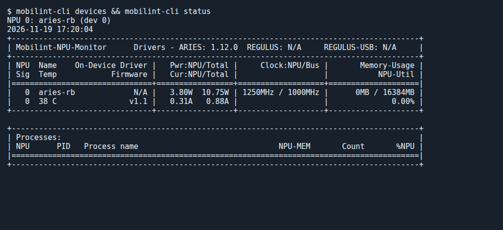
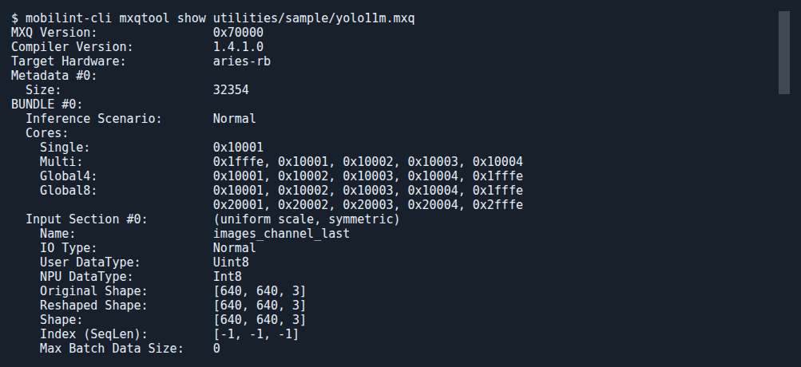
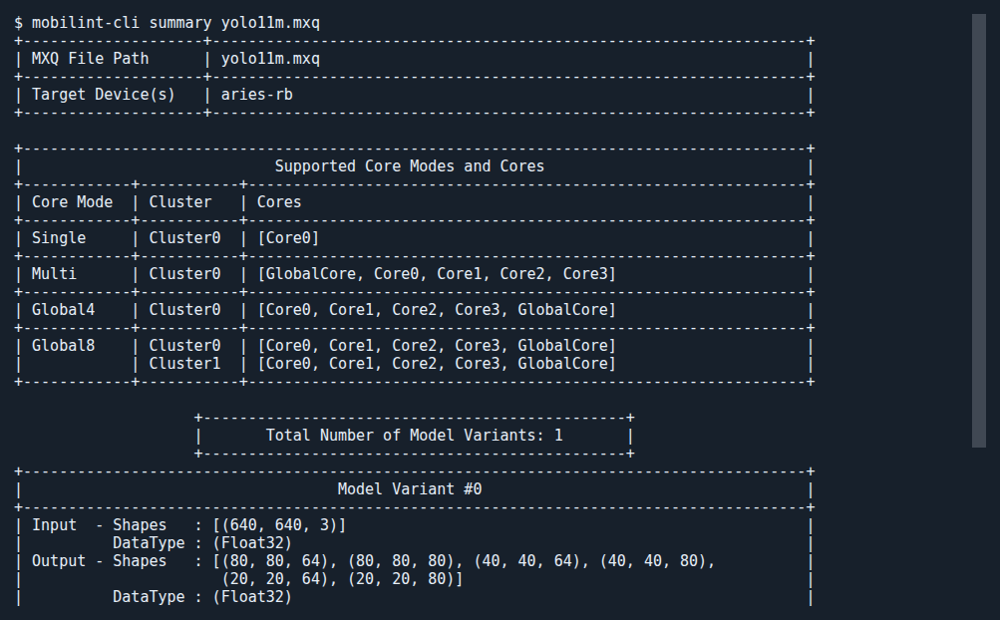
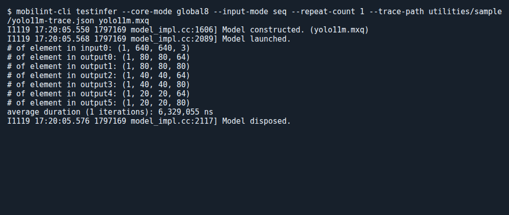
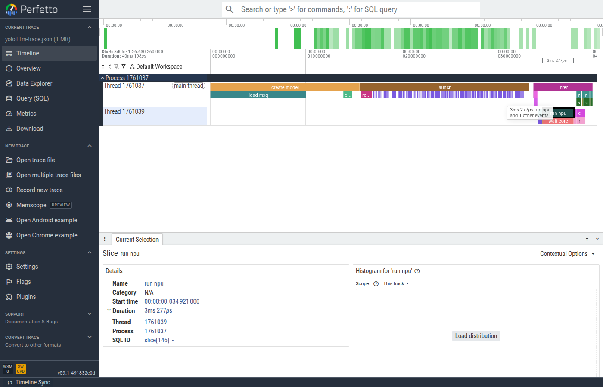
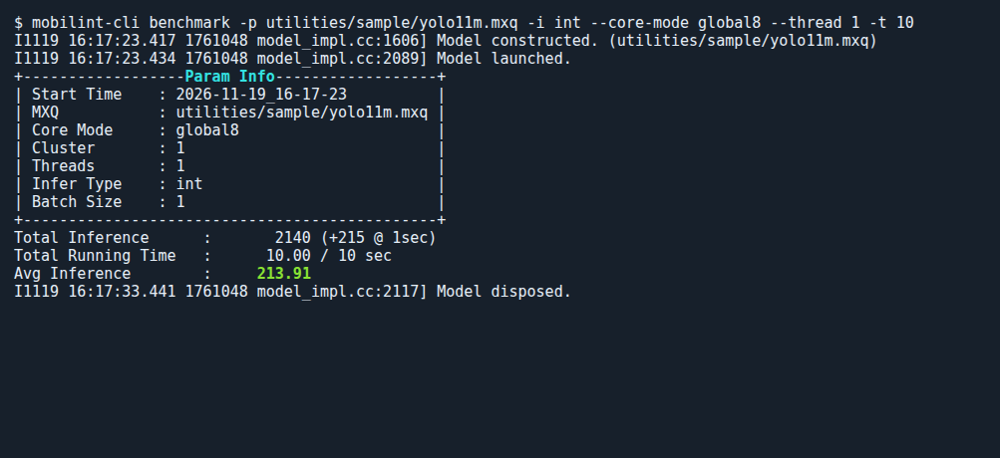

# Use mobilint-cli

English | [한국어](usage.KR.md)

This guide covers common tasks: checking NPU status, inspecting an MXQ file, profiling inference, and measuring throughput.

The examples use CLI v1.6.0 and the [YOLO11m sample for ARIES-RB](../sample/yolo11m.mxq). The model is already compiled.

Run commands that include a model path from the repository root.

## Check NPU status

```bash
mobilint-cli devices
mobilint-cli status
```

- `devices` lists the device number and model name.
- `status` reports temperature, memory use, and utilization for a Mobilint NPU, much like `nvidia-smi` does for an NVIDIA GPU.
- To refresh once per second, run `mobilint-cli status -l 1`. Press `Ctrl+C` to stop.



## mxqtool: Inspect an MXQ file

```bash
mobilint-cli mxqtool show utilities/sample/yolo11m.mxq
```

`show` reads the file without running inference. In the sample output:

- `Compiler Version`: The version of the compiler that built the file, not the installed CLI version.
- `Target Hardware`: The device the model was compiled for (`aries-rb`).
- `Input Section #0`: The first input uses `Uint8` for user data and `Int8` on the NPU.



## summary: Check model requirements

```bash
mobilint-cli summary utilities/sample/yolo11m.mxq
```

`summary` lists the target device, supported core modes, and model inputs and outputs.

- Target: `aries-rb`. The model supports `Single`, `Multi`, `Global4`, and `Global8`. Both examples below use `global8`.
- Input: One `Uint8` tensor of shape `(640, 640, 3)`.
- Output: Six `Float32` tensors.



## testinfer: Profile inference

Record one inference with `testinfer`, then open the trace in Perfetto to inspect the time spent in each stage.

```bash
mobilint-cli testinfer --core-mode global8 --input-mode seq --repeat-count 1 \
  --trace-path yolo11m-trace.json utilities/sample/yolo11m.mxq
```

- `--input-mode seq` generates sequential input values instead of loading a photo.
- `--repeat-count 1` runs one inference.
- `average duration` reports execution time in nanoseconds (ns). It does not measure detection accuracy.

`--trace-path` writes stage events to a JSON file. The command above saves `yolo11m-trace.json` in the current directory.

The screenshot uses `utilities/sample/yolo11m-trace.json` so you can open the same trace as the example.



### Read stage durations in Perfetto

1. In the [Perfetto UI](https://ui.perfetto.dev/), select `Open trace file`.
2. Open the JSON file you just created. Without an NPU, you can download and open the [sample trace](../sample/yolo11m-trace.json) instead.
3. Select an interval on the timeline. Read its `Duration` under `Current Selection`.

In the sample, `create model` took 15.694 ms, `launch` took 17.841 ms, and `infer` took 6.224 ms.

The selected `run npu` interval took 3.277 ms. It overlaps `infer` on another thread. Do not add the two durations.



## benchmark: Measure inference throughput

```bash
mobilint-cli benchmark -p utilities/sample/yolo11m.mxq -i int --core-mode global8 --thread 1 -t 10
```

- `-i int` uses integer input, which this model supports.
- `--thread 1` uses one thread.
- `-t 10` runs inference repeatedly for 10 seconds.

Read the two result fields separately:

- `Total Inference` counts completed inferences.
- `Avg Inference` reports the average number per second, not the time per inference.

The sample run completed 2,140 inferences at an average of 213.91 per second. Use the same model, core mode, and thread count when comparing results.



For more commands and options, see the [official CLI usage guide](https://docs.mobilint.com/runtime/en/v1.6/utility_usage/#mobilint-cli).
